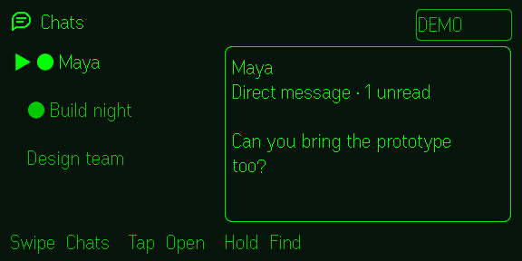

# Fieldline — Telegram on G2

A glasses-first personal Telegram client for Even Realities G2 and the R1 ring. Browse conversations, read message threads, compose, review, send, react, and save messages on the glasses. The phone hosts Even Hub and handles setup; your server maintains the Telegram session and serves the API.

Not affiliated with Telegram or Even Realities.



[88-second glasses-first simulator walkthrough](docs/media/fieldline-glasses-demo.mp4) · [Inbox preview](docs/media/glasses-inbox.png) · [Reply review](docs/media/glasses-review.png) · [Server setup](docs/standalone.md)

**Status:** glasses-only synthetic simulator flows were verified on an earlier build. Telegram sign-in (QR, phone code, 2FA) is implemented and unit-tested against a mocked Telegram, but has **not** been verified against real Telegram or on G2 hardware. Real account delivery, live dictation, physical G2 testing, public server deployment, and DoraHacks submission remain unverified.

## What happens on the glasses

- **Inbox.** Launch directly into chats, with unread conversations first. Rows read like `● Build night · 2`; the preview shows the chat type, unread count and time of the last message (`Group · 2 unread · 3m`, plus `Muted` when the chat's own Telegram notification setting is muted). Swipe to preview and tap to open. Hold in Chats to find a conversation by voice.
- **Threads:** a message is marked read once it is fully on screen (long messages when you finish reading them; search results are not marked). Swiping past the last message opens the next unread chat, or a “You’re caught up” screen. Swipe messages, paginate full text, inspect the original replied-to message, search history and load older messages. Media is identified; view rich media in Telegram.
- **Replies.** Tap an open message to open the review screen with a suggested reply (built-in rules, or an optional model) and swipe for alternatives. Tap **Send now** to send the exact text shown: two taps from the message. A tap within 1 second of opening review is ignored, Double tap goes back without sending, and the server still requires an explicit confirmation. Long replies get a paginated review first. Hold to dictate and release to review. Double tap keeps the draft attached to the source.
- **Actions:** reply as yourself, write a new message, react with thumbs up/heart/check, or forward to Saved Messages. Cancellation preserves a draft. Missing receipts stay uncertain; writes are not automatically retried.
- **Catch-up:** source-linked changes, unanswered questions, replies and your stated commitments, labelled like `Build night · change`. Each card is one page (why plus the quote); Tap opens the source message. Manage its ten-chat selection entirely on G2.
- **Saved Messages:** a real Telegram self-chat, readable and writable from the glasses.

Swipe to select, tap to open, and double tap to go back. Tap then hold for Even Hub shortcuts such as New message, Find in chat, and Next unread chat. Hold on a message to dictate. Model-backed suggestions are optional and fall back to built-in replies. Double tap on Chats asks before exiting: Tap exits, Double tap goes back. The G2 display uses separate context and preview areas, brightness for focus, and native pickers for reactions and characters.

## Quickstart — Demo Mode (No Telegram Account Required)

Node 24.18+ is required for built-in SQLite. This demo runs entirely with synthetic data:

```bash
# Install dependencies
npm ci
npm ci --prefix .tooling

# Build the app
npm run build

# Start the demo server (synthetic Telegram data)
npm run personal:demo

# In another terminal, start the simulator
npm run glasses:simulate
```

**Sign in (demo mode):** open http://127.0.0.1:3003/login. The demo QR "scans" itself after about 3 seconds, or click "Simulate the scan now". The page ends at "Signed in as Demo User" with an "Open your glasses" link (the method tabs hide once signed in). The phone tab accepts any number and any code except `00000` (which shows the wrong-code path). Demo mode makes no Telegram calls and never writes a session file.

**Warning:** `/login` has no owner authentication. Keep this server on localhost and never host it on a public network.

**To pair glasses:** in demo mode the glasses page pairs itself on boot, and again after an expired display session (401), and opens the inbox. If that fails it falls back to the manual flow: Tap for a 6-digit code (it counts down from 5:00; Double tap cancels), then Tap again to approve the demo. A live (non-demo) server never auto-pairs.

**Display mirror:** http://127.0.0.1:3003/glasses.html shows what appears on the glasses.

**Controls:** Swipe to navigate, Tap to open/confirm, Double tap to go back, Hold to dictate (when voice is enabled).

## Real Telegram account (optional)

1. Get your own API credentials at https://my.telegram.org.
2. Copy `.env.example` to `.env` and set `TELEGRAM_API_ID` and `TELEGRAM_API_HASH`.
3. `npm run personal:server`. With no saved session the server starts signed out (Telegram routes answer 503 until you sign in).
4. Open http://127.0.0.1:3003/login and choose **QR Code** (Telegram on your phone: Settings → Devices → Link Desktop Device) or **Phone Number** (code sent by Telegram). Enter your two-step verification password if asked. A wrong code or password asks again.
5. On success the session is written atomically to `.data/personal.session` (mode 0600, git-ignored) and the running server switches to your account without a restart.
6. Pair the glasses: tap for a code on G2, then `npm run personal:approve -- CODE`.

The terminal fallback `npm run personal:login` (phone, code, 2FA) still works and writes the same file.

**Honest status:** sign-in is an explicit state machine (`server/personal/login.ts`) covered by unit tests with a mocked Telegram client and fake timers. It has not been run against real Telegram servers or on G2 hardware. Login routes are rate-limited per IP and allow one sign-in at a time.

**Security:** the session file is account access. Never commit it (`.gitignore` covers `.data/`, `.env*` and `*.session`) or share your credentials.

## Dictation and reply ideas

Set `STT_API_URL` to a Whisper-compatible transcription URL. The optional `STT_API_KEY` and `STT_MODEL` live on the server.

For model-backed suggestions, set `REPLY_AI_URL` to an OpenAI-compatible Chat Completions endpoint that supports JSON Schema output and `max_tokens`. Set `REPLY_AI_MODEL` and, if required, `REPLY_AI_KEY`. The server shares an excerpt of the selected message with this provider when you open reply ideas. You can use a local provider such as [Ollama](https://docs.ollama.com/api/openai-compatibility). The model adds short follow-up questions. Built-in acknowledgements remain available, including when the model is slow or unavailable.

## Server and package

[Backend deployment and API](docs/standalone.md) explains local production execution, the Docker image, persistent storage, API endpoints and the device package. The server serves both the API and the app assets. It is a single-owner backend.

```powershell
npm run server:build
npm start
# Or build a deployable image:
docker build -t fieldline .
# Default package uses glasses.html:
npm run pack
```

Use a reachable HTTPS server for actual glasses. Set FIELDLINE_BACKEND_URL before packing and PERSONAL_ORIGIN on the backend. The packer generates the exact network whitelist. The package requests microphone permission by default. Set FIELDLINE_VOICE=false when packaging a setup without dictation. Localhost packages only work with the local simulator; the phone's localhost is not your computer.

G2 still requires the Even phone app as its SDK/Bluetooth host. “Standalone” here describes the complete glasses interaction flow, with a separate server for Telegram—not independent cellular hardware inside G2.

## Verification

```powershell
npm test
npm run build
npm run server:build
# Fresh synthetic demo + official simulator:
npm run glasses:test
```

82 automated tests (`npm test`) cover the UX pass (auto-mark-read, swipe into the next unread chat, two-tap send with the 1 s guard and server-side confirm, inbox density, demo-only auto-pair, Settings row restore, mute mapping, Catch-up labels),  the sign-in state machine with a mocked Telegram (QR refresh, 2FA and wrong-code retries, cancel, timeouts, atomic save, hot pick-up, rate limits including status polls and page reloads), the login page in jsdom against the demo server, source revision binding, single dispatch, ambiguous delivery, account-wide access boundaries, exact new-message text, Saved Messages, read state, speech formatting, review pagination and cancellation, Disconnect landing on Welcome, and the idle-display health poll. The glasses smoke test drives official SDK gestures and captures 576×288 simulator framebuffers. Tester ran `npm run glasses:test` at `f494e57` on Even Hub simulator 0.9.5 (headed) and recorded a PASS: "11 framebuffers, blank gesture capture, two-tap exact reply, cancellation, inline receipt, native shortcuts, save and reaction." QA independently ran the same script at `f494e57` on a fresh clone (loopback only) and recorded the same PASS; frames now read `Send · Maya` / `Send · Build night`. The smoke script's expectations were updated in `3a11d25`, `a42e831` and `679005c` to match the UX flow. This docs-only pass did not re-run the simulator. No real Telegram messages are sent by these tests.

[Glasses-first verification and setup](docs/standalone.md) · [Submission draft](docs/submission-draft.md) · [Earlier personal prototype](docs/personal-account.md) · [Original bot prototype](docs/crew-prototype.md)

## Source and acknowledgements

Based on the official Even Hub minimal template patterns, SDK 0.0.16, simulator 0.9.5 and CLI 0.2.0. Telegram transport uses Teleproto. Application implementation began November 23, 2026. MIT license; dependency licenses remain their own.

## Build-period disclosure

The workspace was empty when inspected November 18, 2026. These preparation documents were written before November 23. No competition application code was created at this stage. On November 18, official simulator 0.9.5 and CLI 0.2.0 were installed under .tooling with a pinned lockfile, and .gitignore was added for tools, secrets, and generated output. The official rules require building during the hackathon and disclosing everything that existed before November 23. Keep this disclosure and enumerate any subsequent pre-build changes here.

Build opens: November 23, 2026, 08:00 UTC (02:00 America/Chicago).
Submission closes: November 29, 2026, 19:59 UTC (13:59 America/Chicago).

