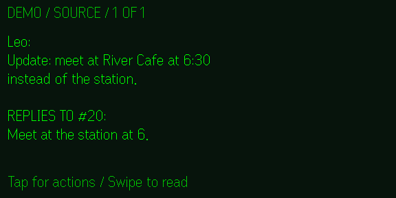

# Fieldline Catch-up — personal-account upgrade

Implemented November 24, during build week. The original single-group bot prototype is retained under its existing commands; this version has a separate account service and UI.



[Watch the personal-account simulator walkthrough](media/fieldline-personal-demo.mp4). All account data and receipts in the recording are synthetic.

## The product

The main question is **“What changed while I was away?”** Source-linked cards highlight explicit change language, replies to your own messages, unread questions, and statements you made about sending, bringing, or checking something. The example shows a meeting moving from the station at 6 to River Cafe at 6:30, linked to its original message. The user can inspect that context and reply, react, or save the source without switching to a phone inbox.

These cards use deterministic rules over selected conversations; they are not AI-generated facts. “Possible plan change” and “something you said you would do” are labelled observations. Completion and deadlines are not inferred. First-run history is limited to the most recent 40 messages per selected chat within the last 24 hours for catch-up. A user-set checkpoint starts a new catch-up window. Ordinary chat history remains accessible separately.

## Run the synthetic preview

```powershell
npm ci
npm run build
npm run personal:demo
# In another terminal:
npm run personal:simulate
```

Open `http://127.0.0.1:3003/personal.html`. Get a pairing code, then approve the explicitly labelled demo. The synthetic account contains three conversations, multiple participants, a changed plan, a direct reply, and your own commitments. Use the real simulator touch/ring controls to open source context, select an action, review, cancel, and confirm.

`npm run personal:test` drives that same official simulator through source context, cancellation, a reply, a reaction, and Saved Messages, saving a report and RGBA framebuffers under `artifacts/personal`. It refuses to run against a live account. The demo transport is separate from Telegram and never makes external writes.

Verification on November 24: TypeScript and production builds pass, all **17 automated tests** pass, and the official simulator journey captured 14 frames with successful reply, reaction, and save outcomes. The [recorded simulator report](evidence/personal-simulator-report.json) is included. The demo service was restarted to restore fresh synthetic conversations before recording the walkthrough. Actual account authorization, live Telegram receipts, and real microphone-to-transcription delivery remain unverified.

## Connect your own account

1. Obtain your own `api_id` and `api_hash` through Telegram's [API development tools](https://core.telegram.org/api/obtaining_api_id). Put them in the ignored `.env` as `TELEGRAM_API_ID` and `TELEGRAM_API_HASH`. A BotFather token is not used for this version.
2. Run `npm run personal:login` yourself in an interactive terminal. Read the displayed Telegram terms, then enter your phone number, Telegram login code, and two-step password if required. Input is hidden; the session is saved to `.data/personal.session` and never printed. The agent does not perform account login for you.
3. Run `npm run personal:server`, open the companion, generate a pairing code, and approve it with `npm run personal:approve -- CODE` in your local terminal. This reads a private local approval key; it is not shared with the browser.
4. Select up to ten conversations in the companion. Only those conversations can be read or acted on. The dialog picker lists up to 100 recent account dialogs.
5. Verify an actual consenting conversation: open a real source, compose a reply, inspect the exact preview on G2, confirm once, and check Telegram for the reply. This live account test has not been performed yet.

## Implemented integration

- Personal DMs and groups, recent message history, unread counts, reply links, edit timestamps, and in-chat search.
- Custom replies as the actual signed-in user, with no bot-name prefix.
- Explicitly confirmed reactions and forwarding to your own Saved Messages.
- Normal read acknowledgements for source content displayed on the glasses; no ghost mode.
- Source revision validation: if the source changed between opening and confirming, the write is rejected for renewed review.
- Persisted operation identity: repeat confirmations do not invoke another external write. Ambiguous writes stay uncertain rather than being retried automatically.
- Channel text history with sponsored text, disclosures, view and click reporting. Rich sponsored media is not yet rendered; those channels ask the wearer to open Telegram instead. Channel content is not repackaged into an ad-free catch-up feed.
- Media messages are labelled with their media type. Downloading/rendering attachments, calls, secret chats, full forum topic browsing, new-recipient composing, and message deletion are not implemented. This is a focused wearable client, not feature parity with all of Telegram.

## Hold-to-dictate

The G2 long-press path captures 16 kHz mono PCM while held, stops on release/background/exit, and asks a configured Whisper-compatible service to transcribe it. The resulting text becomes a reply draft and opens the review screen; it never sends directly.

Set `STT_API_URL` to your transcription endpoint, with optional `STT_API_KEY` and `STT_MODEL`. The endpoint must accept a multipart WAV file and return JSON containing `text`. The server keeps API keys out of the browser and does not retain audio. Pack with `FIELDLINE_VOICE=true` to declare microphone permission. WAV conversion and draft/error handling have automated tests; real microphone-to-transcription verification remains pending a configured service.

## Package

Set `FIELDLINE_APP=personal` before `npm run pack`. Optionally set `FIELDLINE_BACKEND_URL` to a reachable HTTPS origin; otherwise the generated package uses the local simulator backend. Set `PERSONAL_ORIGIN` to the actual WebView origin, or explicitly `*` for bearer-authenticated packaged requests. A phone cannot use the desktop's localhost as its backend. Public device deployment has not been verified.

## Library and verification limits

The account adapter uses Teleproto, the maintained successor documented by the now-archived GramJS package. Type signatures were checked against installed Teleproto 1.234.0. Automated tests exercise adapter dispatch through controlled clients and synthetic transport; they do not prove an account was signed in or that Telegram accepted live actions. The server stores only selected-chat IDs, checkpoint metadata, session/approval credentials, and action hashes/results. Message text is fetched on demand rather than retained as a private conversation archive.

Sources: [Teleproto migration guide](https://docs.teleproto.dev/migrating-from-gramjs), [Telegram API application setup](https://core.telegram.org/api/obtaining_api_id), [Telegram API terms](https://core.telegram.org/api/terms), [sponsored messages API](https://core.telegram.org/method/messages.getSponsoredMessages).
